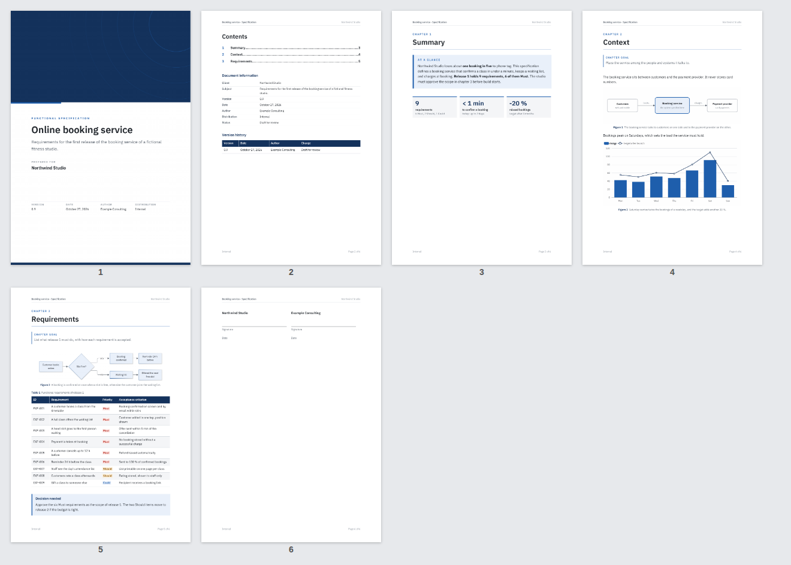

# dossier

A [Claude Code](https://claude.com/claude-code) skill that produces **client-ready documents as Word
and PDF**: status reports, proposals, functional specifications, audits, roadmaps, decision memos,
procedures. From one Markdown source per language, it builds a designed document, then renders every
page so Claude looks at it before handing it over.



## What a document gets

- A cover with the kind, title, subtitle, client, version, date, author and distribution.
- Contents with **real page numbers** (two-pass build) and links, document information, version history.
- Chapters that open on a new page, numbered sections, running header and "Page n of N" footer.
- An executive summary box, chapter goals, key-figure tiles, callouts (note, decision, warning).
- Tables with a dark header, zebra rows, status chips (`{{good:Done}}`), repeated headers, sane page breaks.
- Numbered figures drawn as SVG, Mermaid or ECharts charts, **in the theme's colours and font**.
- IBM Plex Sans embedded in the Word file, so it looks the same on the client's machine.
- Three themes (`sobre`, `chaleur`, `institution`) and brand colour overrides.
- French and English labels, dates and typography.
- Floor checks before the build: placeholders, filler phrases, long sentences, chapters without an
  exhibit, figures without a caption, tables too wide.

The method (brief, plan, writing rules, structures per document type, figure norms, page-by-page
review, reader test with a fresh sub-agent) is in `SKILL.md` and `references/`.

## Install

```bash
curl -fsSL https://raw.githubusercontent.com/koffih/claude-skill-dossier/main/install.sh | bash
```

Requirements: Node 18+, git, Chrome or Chromium, LibreOffice (for the PDF), Poppler
(`pdftoppm`, `pdftotext`). The installer clones the skill into `~/.claude/skills/dossier`, installs
the engine's npm packages and the fonts, and warns about any missing tool.

Options: `--project` (into `./.claude/skills`), `--uninstall`, `--deps-only` (from a clone).

## Use

In Claude Code, ask for the document ("make a Word version of this report for my client, in French
and English") or run `/dossier <what the document is>`. Claude writes the source and the figures,
builds, looks at the pages, fixes and rebuilds.

The engine also runs by hand:

```bash
node ~/.claude/skills/dossier/scripts/build.mjs report.md            # docx + pdf + page images in ./out
node ~/.claude/skills/dossier/scripts/build.mjs report-en.md --out out-en --theme institution
node ~/.claude/skills/dossier/scripts/check.mjs report.md            # checks only
```

See `examples/specification/spec.md` for a complete source using every block, and
`references/source-format.md` for the syntax.

## Test

```bash
tests/smoke.sh
```

## Credits

Builds on the [`docx`](https://github.com/dolanmiu/docx) library, [Mermaid](https://mermaid.js.org),
[Apache ECharts](https://echarts.apache.org) and [IBM Plex](https://github.com/IBM/plex) (SIL Open
Font License, see `assets/fonts/OFL.txt`). Validation of Word files can use the `docx` skill of
[anthropics/skills](https://github.com/anthropics/skills).

## License

MIT for the skill. The bundled fonts keep their own license (SIL OFL 1.1).
